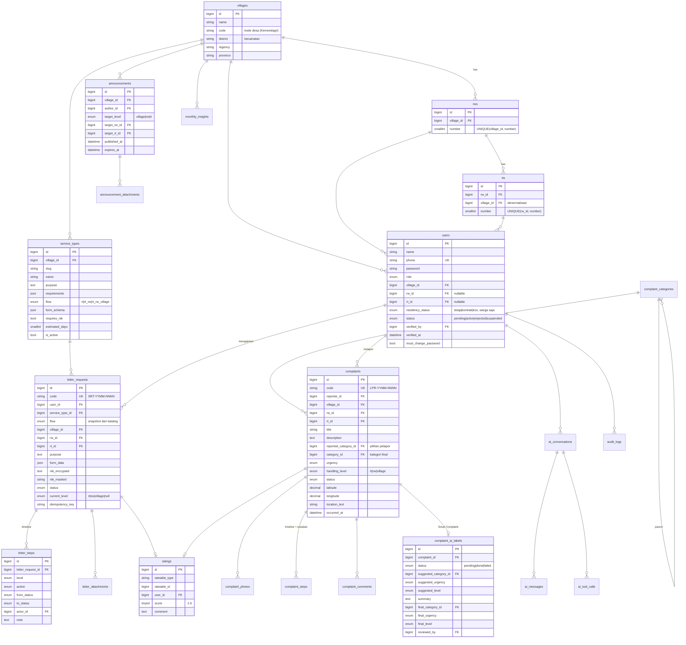

# Rukana — Rancangan Skema Database (MySQL 8)

Status: **draf v1 untuk direview** sebelum migrasi Laravel ditulis.

## Konvensi

- Primary key `id` BIGINT UNSIGNED auto-increment. Yang tampil ke publik hanya **kode tiket**, bukan `id`.
- Nilai status/enum disimpan sebagai kode bahasa Inggris `snake_case` (`submitted`, `rt_verified`, …); label bahasa Indonesia ada di frontend/`lang`.
- Waktu disimpan dalam UTC, ditampilkan dalam `Asia/Jakarta`.
- **Snapshot wilayah**: setiap transaksi (surat, laporan, rating) menyimpan `village_id`, `rw_id`, `rt_id` saat dibuat. Kalau warga pindah RT, riwayatnya tetap tercatat di RT asal, dan query dasbor tidak perlu JOIN ke `users`.
- Tabel riwayat (`*_steps`, `audit_logs`, `ai_tool_calls`) bersifat **append-only**: hanya punya `created_at` dan tidak pernah di-update.

## Scope wilayah (dasar semua otorisasi)

| Peran (`users.role`) | `village_id` | `rw_id` | `rt_id` | Scope data |
|---|---|---|---|---|
| `warga` | ✔ | ✔ | ✔ | data milik sendiri |
| `rt` | ✔ | ✔ | ✔ | RT sendiri |
| `rw` | ✔ | ✔ | – | RW sendiri |
| `operator` | ✔ | – | – | seluruh desa |
| `kepala_desa` | ✔ | – | – | seluruh desa (read-only) |

Satu `ScopeResolver` di backend menurunkan scope dari akun yang login. Scope ini dipakai oleh Policy, query dasbor, ekspor, **dan** tool AI. Scope tidak pernah diambil dari input request.

---

## ERD



---

## Detail tabel

### 1. Wilayah

**`villages`**: `id`, `name`, `code` (nullable, UNIQUE), `district`, `regency`, `province`, `address`, `timestamps`.

**`rws`**: `id`, `village_id` FK, `number` SMALLINT, `name` (nullable, mis. "Dusun Krajan"), `timestamps`. UNIQUE(`village_id`, `number`).

**`rts`**: `id`, `rw_id` FK, `village_id` FK (denormalisasi supaya filter scope desa tidak perlu JOIN), `number`, `timestamps`. UNIQUE(`rw_id`, `number`).

### 2. Akun

**`users`**

| Kolom | Tipe | Catatan |
|---|---|---|
| `name` | VARCHAR(100) | |
| `phone` | VARCHAR(20) UNIQUE | login pakai no. HP, dinormalisasi ke format `62…` |
| `password` | VARCHAR | bcrypt/argon |
| `role` | ENUM `warga, rt, rw, operator, kepala_desa` | |
| `village_id` / `rw_id` / `rt_id` | FK | sesuai tabel scope di atas |
| `residency_status` | ENUM `tetap, kontrak, kos` NULL | hanya untuk warga |
| `status` | ENUM `pending, active, rejected, suspended` | warga mulai dari `pending`, pengurus langsung `active` |
| `verified_by`, `verified_at`, `rejection_reason` | | verifikasi oleh RT/operator |
| `must_change_password` | BOOL | `true` setelah sandi direset RT/operator |
| `last_login_at`, `remember_token`, `timestamps`, `deleted_at` | | |

Index: (`rt_id`, `role`, `status`) untuk antrean verifikasi di dasbor RT.

**Tidak ada kolom NIK atau KK di `users`.** Ini disengaja (minimisasi data).

Satu RT/RW boleh punya lebih dari satu akun pengurus (ketua, sekretaris).

### 3. Katalog layanan

**`service_types`**: `village_id`, `slug`, `name`, `purpose` TEXT, `requirements` JSON (daftar syarat dokumen), `flow` ENUM `rt | rt_rw | rt_rw_village`, `estimated_days`, `notes` TEXT, `form_schema` JSON, `requires_nik` BOOL, `is_active`, `sort_order`, `timestamps`, `deleted_at`. UNIQUE(`village_id`, `slug`).

`form_schema` untuk form dinamis:

```json
[
  { "key": "alamat_tujuan", "label": "Alamat tujuan pindah", "type": "text", "required": true },
  { "key": "jumlah_anggota", "label": "Jumlah anggota keluarga ikut", "type": "number", "required": false },
  { "key": "jenis_usaha", "label": "Jenis usaha", "type": "select", "options": ["Warung", "Jasa", "Lainnya"] }
]
```

### 4. Surat pengantar

**`letter_requests`**

| Kolom | Catatan |
|---|---|
| `code` UNIQUE | `SRT-2610-0042` (YYMM + nomor urut per bulan, lihat `ticket_sequences`) |
| `user_id`, `service_type_id` | |
| `flow` | **snapshot** alur dari katalog, supaya surat yang sedang berjalan tidak berubah kalau katalog diedit |
| `village_id`, `rw_id`, `rt_id` | snapshot wilayah pemohon |
| `purpose` TEXT, `form_data` JSON | keperluan + isian dinamis, disimpan sebagai snapshot `[{key, label, value}]` supaya surat lama tetap terbaca walau label di katalog diubah |
| `nik_encrypted` TEXT NULL | cast `encrypted` Laravel; hanya diisi bila `requires_nik` |
| `nik_masked` VARCHAR(16) NULL | `3204********0001` untuk tampilan dan daftar, tanpa perlu dekripsi |
| `status` | lihat state machine |
| `current_level` ENUM `rt, rw, village` NULL | siapa yang harus bertindak; `NULL` saat status final |
| `rejected_level`, `rejection_reason` | |
| `submitted_at`, `completed_at` | untuk hitung rata-rata waktu proses |
| `idempotency_key` | UNIQUE(`user_id`, `idempotency_key`): submit ganda dari HP tidak membuat dua tiket |

Index: (`village_id`, `status`, `created_at`), (`rt_id`, `status`), (`rw_id`, `status`).

**State machine surat**

| Dari | Aksi (oleh) | Ke |
|---|---|---|
| `submitted` | verify (RT) | `rt_verified`; **atau `completed` bila `flow = rt`** |
| `rt_verified` | approve (RW) | `rw_approved`; **atau `completed` bila `flow = rt_rw`** |
| `rw_approved` | receive (desa) | `village_received` |
| `village_received` | mark_ready (desa) | `ready_for_pickup` |
| `ready_for_pickup` | mark_picked_up (desa) | `completed` |
| status non-final mana pun | reject (pihak di `current_level`) | `rejected` (alasan wajib) |

> Asumsi: untuk alur `rt` dan `rt_rw`, surat dianggap **selesai** begitu tingkat terakhir menyetujui, karena warga tinggal mencetak/mengambil pengantar. Perlu dikonfirmasi saat observasi.

**`letter_steps`** (timeline, append-only): `letter_request_id`, `level`, `action` ENUM `submitted, verified, approved, received, ready, picked_up, rejected`, `from_status`, `to_status`, `actor_id`, `note`, `created_at`. Tabel ini juga sumber data register pengantar per RT/RW dan halaman cek tiket publik (yang hanya menampilkan `action`, `level`, `created_at`).

**`letter_attachments`**: `letter_request_id`, `uploaded_by`, `requirement_label` (syarat mana yang dipenuhi), `disk`, `path`, `original_name`, `mime`, `size_bytes`, `created_at`. Disimpan di disk privat dan diakses lewat endpoint yang dicek Policy.

### 5. Laporan warga

**`complaint_categories`**: `id`, `parent_id` NULL, `name`, `slug`, `default_level` ENUM NULL, `sort_order`, `is_active`. Dua tingkat:

- **Infrastruktur**: Jalan Rusak, Lampu Jalan Mati, Saluran Air Mampet
- **Kebersihan**: Sampah Menumpuk
- **Fasilitas Umum**: Fasilitas Umum Rusak
- **Keamanan**: Gangguan Keamanan
- **Lainnya**

Warga memilih subkategori. AI menyarankan kategori dengan ID dari tabel yang sama, jadi akurasi bisa dibandingkan langsung.

**`complaints`**

| Kolom | Catatan |
|---|---|
| `code` UNIQUE | `LPR-2610-0117` |
| `reporter_id` | identitas hanya dibuka ke pengurus yang menangani (Policy + API Resource) |
| `village_id`, `rw_id`, `rt_id` | snapshot RT pelapor; laporan masuk ke RT ini |
| `title`, `description` | |
| `reported_category_id` | pilihan pelapor (tidak berubah) |
| `category_id` | kategori final (bisa dikoreksi pengurus) |
| `urgency` ENUM `low, medium, high` NULL | ditetapkan pengurus |
| `handling_level` ENUM `rt, rw, village` | yang sedang memegang laporan |
| `status` | lihat state machine |
| `latitude`, `longitude` DECIMAL(10,7) NULL | dari Geolocation browser |
| `location_text` | alternatif isi manual / patokan |
| `occurred_at` | waktu kejadian |
| `rejection_reason`, `verified_at`, `resolved_at` | |
| `idempotency_key` | sama seperti surat |

Index: (`village_id`, `status`, `created_at`), (`rt_id`, `status`), (`handling_level`, `status`), (`category_id`, `created_at`), (`latitude`, `longitude`) untuk peta.

**State machine laporan**

| Dari | Aksi | Ke |
|---|---|---|
| `submitted` | verify (RT) | `verified` |
| `verified` | start (pemegang) | `in_progress` |
| `verified`, `forwarded`, `in_progress` | forward → RW / desa (hanya ke tingkat di atas pemegang) | `forwarded` (`handling_level` berubah) |
| `forwarded` | accept (penerima) | `in_progress` (RW tetap bisa meneruskan ke desa, sebelum atau sesudah menerima) |
| `in_progress` | resolve | `resolved` |
| `submitted`, `verified`, `forwarded` | reject (alasan wajib) | `rejected` |

Hanya tingkat yang sedang memegang laporan (`handling_level`) yang bisa bertindak. Identitas pelapor dan catatan internal hanya terlihat oleh pengurus di tingkat yang pernah memegang laporan (RT pelapor + tujuan setiap eskalasi); kepala desa dan tingkat lain melihat "Pelapor".

**`complaint_steps`** (timeline, append-only): `complaint_id`, `action` ENUM `submitted, verified, forwarded, accepted, started, resolved, rejected, category_corrected`, `from_level`, `to_level`, `from_status`, `to_status`, `actor_id`, `note`, `created_at`.

> Penyesuaian dari PRD: tabel `complaint_escalations` **digabung** ke `complaint_steps` (eskalasi = step dengan `action = forwarded`, `from_level`/`to_level`). Timeline tetap satu sumber dan jumlah eskalasi tinggal di-COUNT.

**`complaint_photos`**: `complaint_id`, `disk`, `path`, `mime`, `size_bytes`, `width`, `height`, `created_at`. Foto dikompresi di server dan disimpan di disk privat.

**`complaint_comments`**: `complaint_id`, `user_id`, `body`, `is_internal` BOOL (`false` = tanggapan yang terlihat pelapor, `true` = catatan antar-pengurus), `timestamps`.

**`complaint_ai_labels`** (Smart Complaint, satu per laporan)

| Kolom | Catatan |
|---|---|
| `status` ENUM `pending, done, failed` | diproses lewat queue |
| `model`, `prompt_version` | supaya akurasi bisa dibandingkan antar-versi prompt |
| `suggested_category_id`, `suggested_urgency`, `suggested_level`, `summary` | output AI |
| `raw_output` JSON, `error` | debugging |
| `final_category_id`, `final_urgency`, `final_level` | keputusan pengurus |
| `reviewed_by`, `reviewed_at` | |

Akurasi = persentase `suggested_* = final_*` pada label yang sudah direview (target ≥ 80%).

### 6. Rating

**`ratings`**: `rateable_type` (`letter_request` | `complaint`), `rateable_id`, `user_id`, `score` TINYINT (CHECK 1–5), `comment` VARCHAR(500) NULL, snapshot `village_id`, `rw_id`, `rt_id`, `service_type_id` NULL (untuk rata-rata per layanan), `category_id` NULL (per kategori laporan), `created_at`. UNIQUE(`rateable_type`, `rateable_id`): satu rating per tiket.

### 7. Pengumuman & notifikasi

**`announcements`**: `village_id`, `author_id`, `title`, `body` TEXT, `target_level` ENUM `village, rw, rt`, `target_rw_id` NULL, `target_rt_id` NULL, `published_at`, `expires_at` NULL, `timestamps`, `deleted_at`. Index (`village_id`, `published_at`).
Aturan: RT hanya boleh menargetkan RT-nya sendiri, RW hanya RW-nya sendiri, operator bebas di dalam desanya (divalidasi lewat ScopeResolver).
Warga melihat pengumuman yang `target_level = village` ATAU `target_rw_id = rw_id-nya` ATAU `target_rt_id = rt_id-nya`.

**`announcement_attachments`**: `announcement_id`, `disk`, `path`, `original_name`, `mime`, `size_bytes`.

**`notifications`**: tabel bawaan Laravel (`uuid id`, `type`, `notifiable_*`, `data` JSON, `read_at`), untuk ikon lonceng.

### 8. AI

**`ai_conversations`**: `user_id`, `scope_level`, `scope_id` (snapshot scope saat percakapan dibuat), `title`, `timestamps`.

**`ai_messages`**: `ai_conversation_id`, `role` ENUM `user, assistant`, `content` TEXT, `model`, `input_tokens`, `output_tokens`, `created_at`. *(Ditambahkan; di PRD belum ada tempat untuk isi percakapan.)*

**`ai_tool_calls`** (append-only): `feature` ENUM `ask, smart_complaint, monthly_insight`, `user_id` NULL, `ai_conversation_id` NULL, `subject_type`/`subject_id` NULL (mis. complaint), `tool_name`, `arguments` JSON (**termasuk scope yang disisipkan backend**), `result` JSON (agregat saja, tanpa data pribadi), `status`, `duration_ms`, `created_at`. Tabel ini menjadi bukti untuk UAT 11.

**`monthly_insights`**: `village_id`, `rw_id` NULL (NULL = tingkat desa), `period` DATE (tanggal 1 bulan tsb), `metrics` JSON (**angka yang dihitung backend**, jadi narasi dan dasbor dijamin memakai angka yang sama), `narrative` TEXT, `model`, `generated_by`, `generated_at`, `status`. UNIQUE(`village_id`, `rw_id`, `period`). *(Ditambahkan supaya insight tidak di-generate ulang setiap kali dibuka.)*

### 9. Sistem

**`audit_logs`** (append-only): `user_id` NULL, `action` VARCHAR (mis. `letter.status_changed`, `complaint.forwarded`, `user.verified`, `user.password_reset`, `auth.access_denied`, `export.downloaded`, `ai.invoked`), `subject_type`, `subject_id`, `ip`, `user_agent`, `metadata` JSON, `created_at`. Index (`subject_type`, `subject_id`), (`action`, `created_at`), (`user_id`, `created_at`).

**`ticket_sequences`**: PK (`prefix`, `period`), `last_number`. Nomor tiket dibuat di dalam transaksi dengan `SELECT … FOR UPDATE`, jadi tidak ada kode ganda walau dua warga submit bersamaan.

Tabel bawaan Laravel: `sessions` (Sanctum SPA memakai sesi), `cache`, `jobs`, `failed_jobs`, `job_batches`.

---

## Keputusan yang perlu dikonfirmasi

1. Untuk alur `rt` / `rt_rw`, surat langsung `completed` setelah tingkat terakhir menyetujui (lihat state machine surat).
2. `complaint_escalations` digabung ke `complaint_steps`.
3. Tambahan di luar PRD: `ai_messages`, `monthly_insights`, `complaint_photos`, `complaint_categories`, `ticket_sequences`, `announcement_attachments`.
4. Login memakai **no. HP + kata sandi** (tanpa email).
5. Pengumuman hanya punya **satu** target per pengumuman (desa / satu RW / satu RT).
